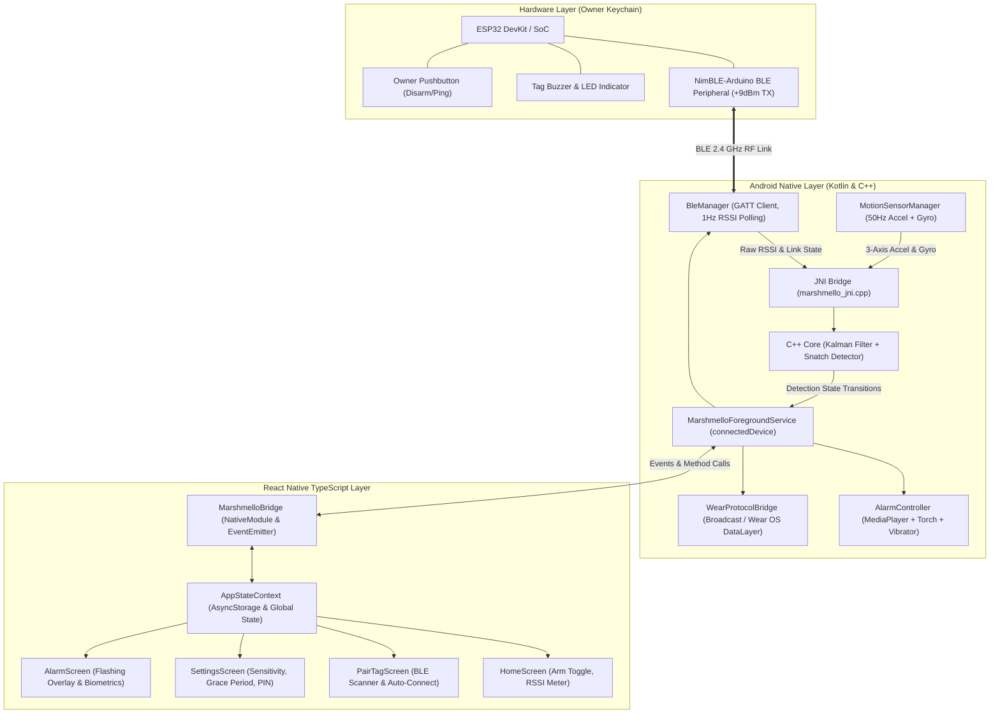

# Marshmello System Architecture

Marshmello is an anti-snatch-theft safety system built with a multi-layered hardware, firmware, native signal-processing, and mobile UI stack.

---

## 1. Multi-Layer Architecture Diagram

---

## 2. Core Detection Mathematics & State Machine

### A. 1D Kalman Filter for RSSI Smoothing
Radio frequency propagation in urban streets suffers from severe multipath reflections, Rayleigh fading, and body shadowing. A raw RSSI signal can fluctuate by $\pm 12\text{ dBm}$ without any physical movement.

The 1D Kalman filter computes optimal recursive minimum mean-square error estimates:

1. **Prediction Step**:
   $$\hat{x}_{k|k-1} = \hat{x}_{k-1|k-1}$$
   $$P_{k|k-1} = P_{k-1|k-1} + Q$$
   *(where $Q = 0.12$ represents physical displacement process noise)*

2. **Rate Limiting & Outlier Clamping**:
   $$z_k' = \text{clamp}(z_k, \hat{x}_{k|k-1} - 25, \hat{x}_{k|k-1} + 25)$$

3. **Correction Step**:
   $$K_k = \frac{P_{k|k-1}}{P_{k|k-1} + R}$$
   $$\hat{x}_{k|k} = \hat{x}_{k|k-1} + K_k \cdot (z_k' - \hat{x}_{k|k-1})$$
   $$P_{k|k} = (1 - K_k) \cdot P_{k|k-1}$$
   *(where $R = 4.0$ represents RF antenna measurement jitter)*

### B. Snatch Motion & Displacement Fusion
A true snatch theft involves three sequential physical phases:
1. **Violent Rip / Jerk**:
   $$|a| = \sqrt{a_x^2 + a_y^2 + a_z^2}, \quad |\omega| = \sqrt{\omega_x^2 + \omega_y^2 + \omega_z^2}$$
   $$J = \frac{\left| |a_t| - |a_{t-1}| \right|}{\Delta t} \ge 28.0\text{ m/s}^3 \quad \text{with} \quad |a| \ge 22.0\text{ m/s}^2$$
2. **Sustained Running / Vehicle Escape**:
   $$\sigma_a^2 = \frac{1}{N} \sum_{i=1}^{N} (|a_i| - \mu_a)^2 \ge 5.0\text{ m}^2/\text{s}^4 \quad (N=40 \approx 0.8\text{s})$$
3. **RF Collapse**:
   $$\hat{x}_{\text{RSSI}} < \text{Threshold} \quad \text{or} \quad \text{BLE Link Disconnect}$$

When Phase 1 triggers, the detector enters `STATE_MOTION_SUSPICIOUS` for $3500\text{ ms}$. If Phase 2 and 3 coincide inside this window, the alarm triggers immediately without waiting for the full range grace countdown. If the phone is dropped or merely jostled, Phase 2 fails ($\sigma_a^2 \approx 0$) or Phase 3 fails (tag remains nearby), safely returning to `STATE_IDLE_ARMED`.

