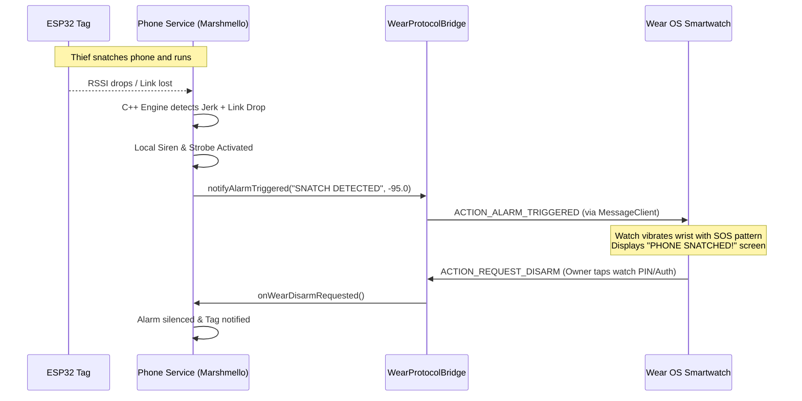

# Wear OS Smartwatch Companion Architecture

The Marshmello architecture is modularized so a Wear OS smartwatch companion app can be integrated directly as a companion Gradle module (`:wear`) or standalone app communicating over Google Play Services Wearable Data Layer.

---

## 1. Protocol Architecture & Flow



---

## 2. Shared Protocol Actions & Data Payloads

As defined in [`WearProtocolBridge.kt`](file:///home/suyash/Marshmello/android/app/src/main/java/com/marshmello/wear/WearProtocolBridge.kt):

| Action Constant | Direction | Payload Keys | Purpose |
| :--- | :--- | :--- | :--- |
| `com.marshmello.wear.ALARM_TRIGGERED` | Phone -> Watch | `extra_alarm_reason` (String), `extra_rssi` (Float) | Triggers high-priority haptic alert & emergency watch screen. |
| `com.marshmello.wear.ALARM_DISARMED` | Phone -> Watch | None | Silences watch vibration when owner disarms from phone. |
| `com.marshmello.wear.STATUS_UPDATE` | Phone -> Watch | `extra_is_armed`, `extra_tag_connected`, `extra_tag_battery`, `extra_rssi` | Updates Watch Face Complication and Tile. |
| `com.marshmello.wear.REQUEST_DISARM` | Watch -> Phone | None | Sent when owner confirms biometric/PIN on the watch. |
| `com.marshmello.wear.REQUEST_ARM_TOGGLE` | Watch -> Phone | `extra_is_armed` (Boolean) | Allows toggling armed status from watch tile. |

---

## 3. Implementing the `:wear` Module (Next Steps)

To add the Wear OS module:
1. In `android/settings.gradle`, add:
   ```groovy
   include ':wear'
   ```
2. In `wear/build.gradle`:
   ```groovy
   dependencies {
       implementation "androidx.wear.compose:compose-material:1.3.1"
       implementation "com.google.android.gms:play-services-wearable:18.1.0"
   }
   ```
3. Use `WearableListenerService` to receive Google Play Services Wearable messages:
   ```kotlin
   class WearDataListenerService : WearableListenerService() {
       override fun onMessageReceived(messageEvent: MessageEvent) {
           when (messageEvent.path) {
               "/marshmello/alarm" -> {
                   // Wake watch screen, trigger emergency haptic vibration
               }
               "/marshmello/status" -> {
                   // Update complication
               }
           }
       }
   }
   ```

